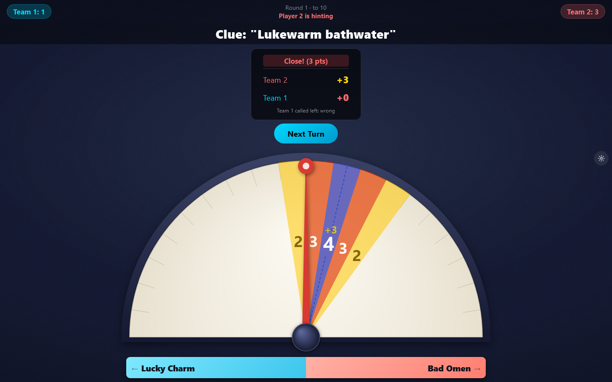
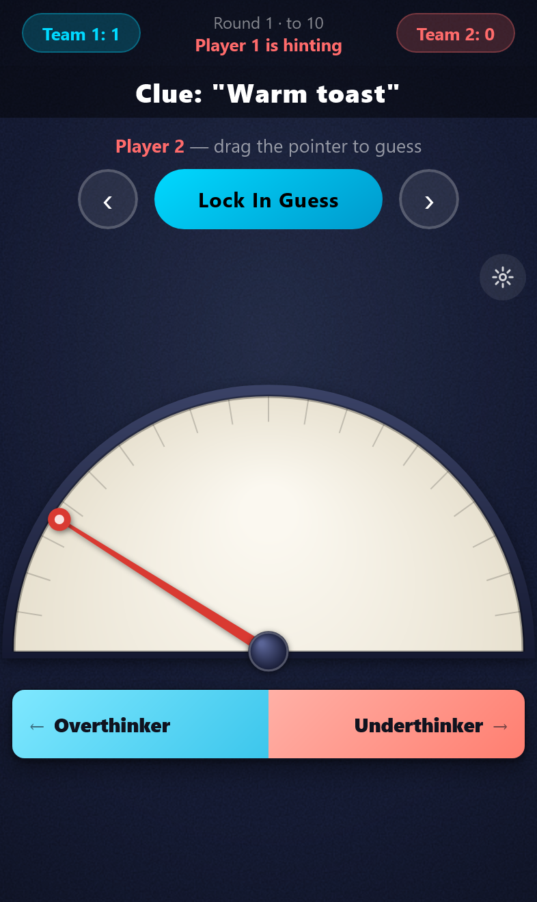
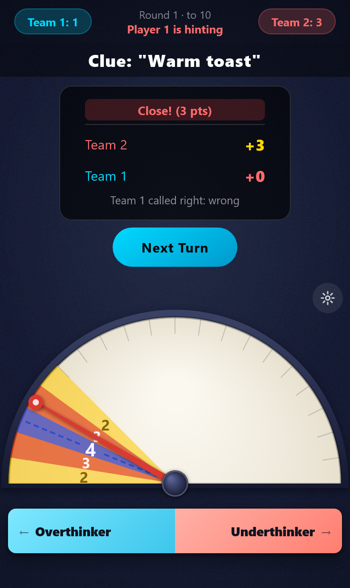

# Wavelength

A browser version of the party game Wavelength for two teams sharing one screen: one player gives a clue, their team turns the dial, and everyone finds out how close they got.

**[▶ Open the live app](https://timothyhadfield.github.io/wavelength/)** · works on phone and laptop · installs to the home screen and plays offline

  
  &nbsp;
  

## Features
- **A real dial**: drag the needle (mouse or touch), or tap anywhere on the dial; ‹ › buttons and the arrow keys move it one degree at a time, with a soft click per section.
- **Hidden target, fair turns**: a "look away" screen hands the device to the clue-giver, who is the only one to see the target before typing a clue.
- **Shutter reveal**: the cover swings open over the target, then the bands score it: 4 for a bullseye, 3 for close, 2 for near.
- **Counter-guess**: the other team calls left or right of the guess to steal a point.
- **471 original spectrum cards** in 11 lists (food, people, places, feelings, silly ones and more), plus your own lists, all saved on the device. Cards you've seen come last next game.
- **Sounds and animations**, each with an on/off switch in Settings.
- **My stats**: games played and 8 achievements (Bullseye, Mind reader, Hat trick, ...).
- **Never loses a game**: a reload or a dropped tab comes back to the same turn.

  

## Built with
Plain HTML, CSS and JavaScript (the dial is drawn on a canvas), no build step, hosted on GitHub Pages. Shared kits from Tim's game sites: sounds/effects, table look, My stats and home-screen install.

## How to play
One player is the **Hinter**. They see a hidden target somewhere on a spectrum between
two opposites, and give their team a single clue. The team then argues about where on
that spectrum the target sits and locks in a guess. The closer they land, the more
points they score. The other team then calls which side of the guess the real target fell on.

Set up your teams and player names, and the app handles turn order, the spectrum cards,
the dial and the scoring. The **?** button on the menu has the full rules.

## Install on iPhone
Open the live link in Safari, tap **Share**, then **Add to Home Screen**. Open it once while online; after that it also works with no connection.

## Running it
Serve the folder with any static server (for example `python -m http.server 8110`) and open http://localhost:8110/.
Tests: `npm test` (cards + achievements), `npm run e2e`, `npm run layout`, `npm run pwa` (need Playwright).
